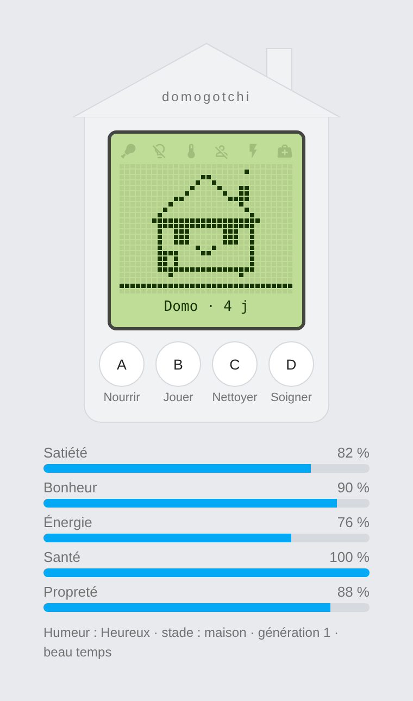
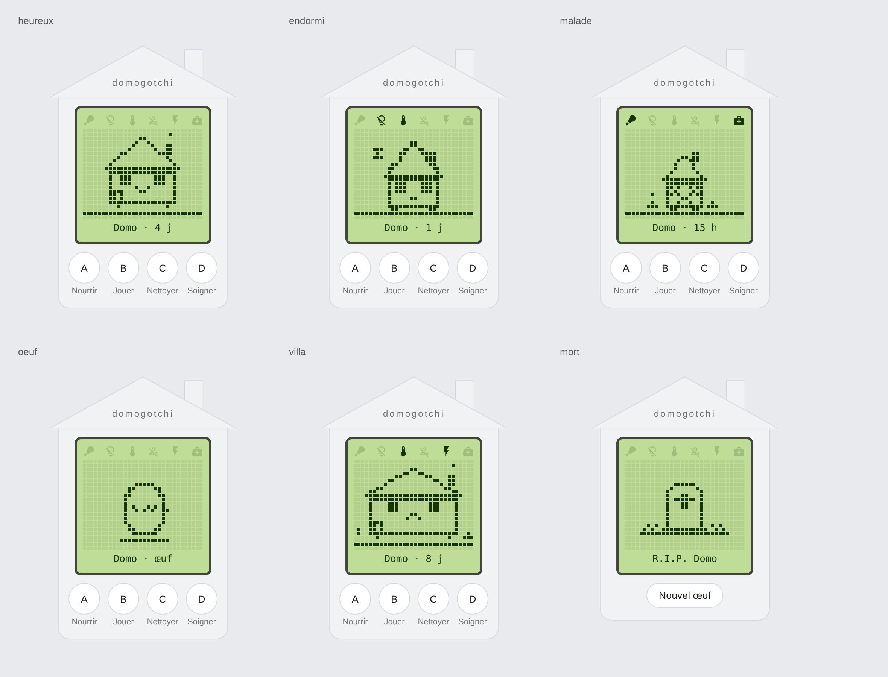
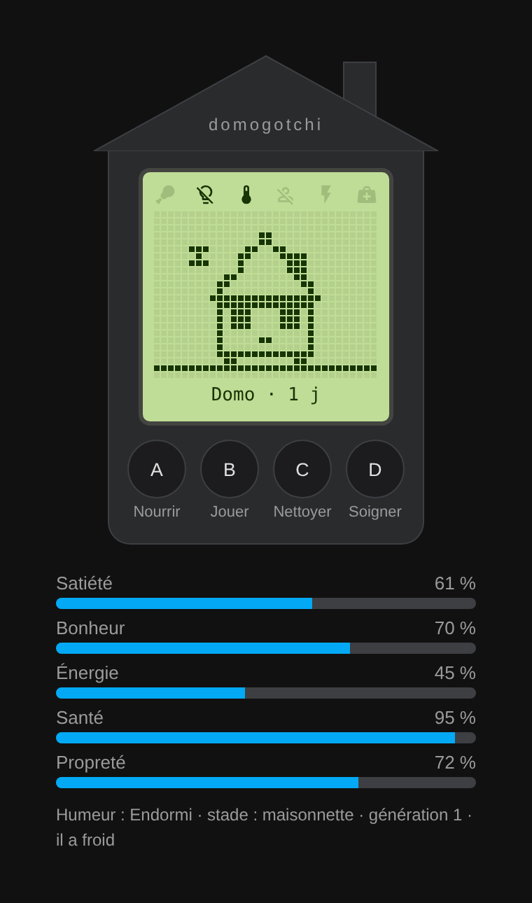
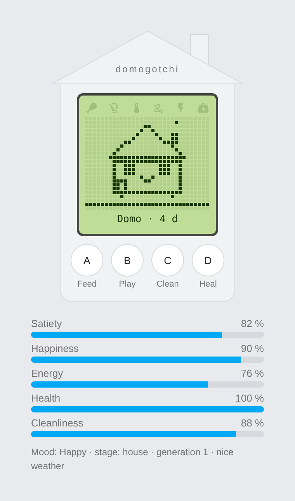
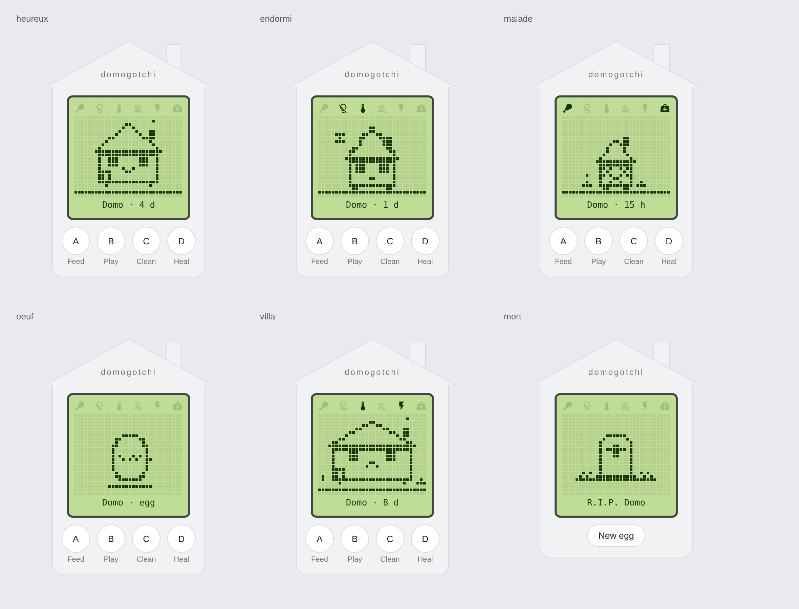

# Domogotchi

[](https://github.com/akoonet-homeassistant/domogotchi/releases/latest)
[](LICENSE)
[](https://hacs.xyz)

🇫🇷 Français · [🇬🇧 English](#english)

Une créature-maison façon Tamagotchi qui vit dans Home Assistant. Elle a faim, elle s'ennuie, elle grandit… et elle réagit à ta vraie maison : elle s'endort quand les lumières s'éteignent, a froid quand la température baisse, se sent seule quand personne n'est là, stresse quand la consommation s'envole et boude sous la pluie.



## Fonctionnalités

- Cycle de vie complet : œuf → cabane → maisonnette → maison → villa, puis ruine si elle est négligée trop longtemps.
- Cinq jauges : satiété, bonheur, énergie, santé, propreté.
- Quatre actions : nourrir, jouer, nettoyer, soigner (avec refus quand elle dort, qu'elle est trop fatiguée ou déjà rassasiée).
- Liens facultatifs avec la maison réelle, réglables à tout moment dans les options.
- Carte Lovelace `domogotchi-card` intégrée, en français ou en anglais selon la langue de Home Assistant : écran LCD rétro, maison en pixel art dont les fenêtres sont les yeux, cheminée qui fume, neige sur le toit quand il fait froid, volets croisés quand elle est malade, fenêtres éteintes quand elle dort.
- État conservé entre les redémarrages (rattrapage plafonné à 12 h pour qu'un arrêt de Home Assistant ne la tue pas).



## Installation

### HACS / Marketplace (recommandé)

Domogotchi fait partie des dépôts **HACS par défaut / Marketplace par défaut** : il apparaît directement dans la recherche de HACS ou du Marketplace.

[](https://my.home-assistant.io/redirect/hacs_repository/?owner=akoonet-homeassistant&repository=domogotchi&category=integration)

1. Ouvre **HACS** (ou le **Marketplace**) dans Home Assistant et recherche **Domogotchi**.
2. Clique sur **Télécharger**, puis redémarre Home Assistant.
3. **Paramètres → Appareils et services → Ajouter une intégration → Domogotchi**.

### HACS / Marketplace (dépôt personnalisé, en secours)

Si Domogotchi n'apparaît pas dans la recherche : Hacs / Marketplace → menu ⋮ → **Dépôts personnalisés**, ajoute `https://github.com/akoonet-homeassistant/domogotchi` en catégorie **Intégration**, puis reprends à l'étape 2.

### Manuelle

Copie `custom_components/domogotchi` dans le dossier `config/custom_components/` puis redémarre.

## Configuration

**Paramètres → Appareils et services → Ajouter une intégration → Domogotchi.**

| Champ | Effet sur la créature |
|---|---|
| Nom | Nom affiché sur l'écran et nom de l'appareil |
| Lumières | Elle dort quand toutes ces lumières sont éteintes. Sans lumière choisie : sommeil de 22 h à 7 h |
| Capteur de température + plage de confort | Elle a froid ou chaud hors de la plage (18–24 °C par défaut) ; en dessous de 14 °C ou au-dessus de 28 °C, sa santé baisse |
| Présence | Elle s'ennuie quand personne n'est là (`person`, `device_tracker`, `binary_sensor`, `input_boolean` ou `zone`) |
| Capteur de puissance + seuil | Elle stresse au-dessus du seuil (3 000 W par défaut, les kW sont convertis) |
| Météo | Le soleil la réjouit, la pluie, la neige ou l'orage la dépriment |

Tous les liens sont facultatifs. On peut créer plusieurs créatures.

## La carte

La ressource est chargée automatiquement par l'intégration, rien à déclarer. Dans un tableau de bord : **Ajouter une carte → Domogotchi**, ou en YAML :

```yaml
type: custom:domogotchi-card
entity: sensor.domo_humeur
show_stats: true
```

`entity` est le capteur **Humeur** de la créature ; `show_stats: false` masque les jauges sous la maison.



## Entités

Les identifiants dépendent du nom choisi et de la langue de Home Assistant ; exemples pour une créature « Domo » en français.

| Entité | Type | Description |
|---|---|---|
| `sensor.domo_satiete` | % | 100 = rassasiée, 0 = affamée |
| `sensor.domo_bonheur` | % | Baisse avec le temps, la solitude, le stress, l'inconfort et la pluie ; remonte en jouant |
| `sensor.domo_energie` | % | Se vide éveillée, se recharge en dormant |
| `sensor.domo_sante` | % | Baisse quand une jauge est à zéro, que la maison est très sale ou que la température est extrême |
| `sensor.domo_proprete` | % | Baisse avec le temps et les repas ; des petits tas apparaissent à l'écran sous 40 % |
| `sensor.domo_age` | jours | Âge depuis la ponte |
| `sensor.domo_stade` | énumération | `oeuf`, `cabane`, `maisonnette`, `maison`, `villa`, `mort` |
| `sensor.domo_humeur` | énumération | `heureux`, `content`, `triste`, `affame`, `fatigue`, `froid`, `chaud`, `sale`, `seul`, `stresse`, `endormi`, `malade`, `oeuf`, `mort` ; porte en attributs tout l'état utilisé par la carte |
| `sensor.domo_generation` | nombre | Augmente à chaque nouvel œuf |
| `binary_sensor.domo_malade` | problème | Santé passée sous 30 % ; se soigne avec le bouton Soigner |
| `binary_sensor.domo_endormi` | marche/arrêt | Elle dort |
| `binary_sensor.domo_vivant` | marche/arrêt | Elle est en vie |
| `binary_sensor.domo_besoin_d_attention` | marche/arrêt | Malade, ou une jauge sous 25 % (pratique pour une notification) |
| `button.domo_nourrir` | bouton | +35 satiété ; si elle est déjà à plus de 90 %, elle a trop mangé |
| `button.domo_jouer` | bouton | +30 bonheur, −10 énergie ; refusé si elle dort, est malade ou épuisée |
| `button.domo_nettoyer` | bouton | Propreté à 100 % |
| `button.domo_soigner` | bouton | +30 santé, guérit la maladie |

### Service

`domogotchi.reset` : remplace la créature par un nouvel œuf (génération suivante). Sans `config_entry_id`, s'applique à toutes les créatures.

## Exemple : notification quand elle a besoin de toi

```yaml
alias: Domogotchi a besoin d'attention
triggers:
  - trigger: state
    entity_id: binary_sensor.domo_besoin_d_attention
    to: "on"
    for: "00:10:00"
actions:
  - action: notify.notify
    data:
      title: Domogotchi
      message: >-
        {{ state_attr('sensor.domo_humeur', 'nom') }} est
        {{ states('sensor.domo_humeur') }} et réclame de l'attention.
mode: single
```

## Règles du jeu

Les vitesses sont des choix de gameplay, pas des mesures : environ trois repas, deux parties de jeu et un ménage par jour suffisent à la garder en forme. Sans aucun soin, elle tombe malade en moins d'une journée puis meurt au bout d'environ un jour et demi. Toutes les valeurs sont regroupées en tête de `engine.py` pour être ajustées.

---

<a id="english"></a>
# Domogotchi (English)

A Tamagotchi-style house creature living in Home Assistant. It gets hungry, bored, grows up… and reacts to your real home: it falls asleep when the lights go off, feels cold when the temperature drops, gets lonely when nobody is home, stressed when power consumption soars, and sulks in the rain.



## Features

- Full life cycle: egg → hut → cottage → house → villa, then a ruin if neglected for too long.
- Five gauges: satiety, happiness, energy, health, cleanliness.
- Four actions: feed, play, clean, heal (refused while asleep, exhausted or already full).
- Optional links with the real home, editable anytime in the options.
- Built-in `domogotchi-card` Lovelace card, in English or French following the Home Assistant language: retro LCD screen, pixel-art house whose windows are its eyes, smoking chimney, snow on the roof when cold, crossed shutters when sick, dark windows when asleep.
- State kept across restarts (catch-up capped at 12 h so a Home Assistant outage does not kill it).



## Installation

### HACS / Marketplace (recommended)

Domogotchi is part of the **HACS default / Marketplace** repositories: it shows up directly when searching in HACS or the Marketplace.

[](https://my.home-assistant.io/redirect/hacs_repository/?owner=akoonet-homeassistant&repository=domogotchi&category=integration)

1. Open **HACS** (or the **Marketplace**) in Home Assistant and search for **Domogotchi**.
2. Click **Download**, then restart Home Assistant.
3. **Settings → Devices & services → Add integration → Domogotchi**.

### HACS / Marketplace (custom repository, fallback)

If Domogotchi does not show up in the search: HACS / Marketplace → ⋮ → **Custom repositories**, add `https://github.com/akoonet-homeassistant/domogotchi` as **Integration**, then continue from step 2.

### Manual

Copy `custom_components/domogotchi` into `config/custom_components/` and restart.

## Configuration

**Settings → Devices & services → Add integration → Domogotchi.**

| Field | Effect |
|---|---|
| Name | Shown on screen and used as device name |
| Lights | Sleeps when all these lights are off. Without lights: sleeps 22:00–07:00 |
| Temperature sensor + comfort range | Cold or hot outside the range (18–24 °C default); below 14 °C or above 28 °C its health drops |
| Presence | Lonely when nobody is home (`person`, `device_tracker`, `binary_sensor`, `input_boolean` or `zone`) |
| Power sensor + threshold | Stressed above the threshold (3,000 W default, kW converted) |
| Weather | Sunshine cheers it up; rain, snow or storms bring it down |

All links are optional. Several creatures can be created.

## The card

The resource is registered automatically by the integration.

```yaml
type: custom:domogotchi-card
entity: sensor.domo_mood
show_stats: true
```

`entity` is the creature's **Mood** sensor; `show_stats: false` hides the gauges.

## Entities

Entity IDs depend on the creature name and your Home Assistant language; examples for a creature named "Domo" in English.

| Entity | Type | Description |
|---|---|---|
| `sensor.domo_satiety` | % | 100 = full, 0 = starving |
| `sensor.domo_happiness` | % | Drops over time, with loneliness, stress, discomfort and rain; rises when playing |
| `sensor.domo_energy` | % | Drains while awake, recharges while asleep |
| `sensor.domo_health` | % | Drops when a gauge hits zero, the house is very dirty or the temperature is extreme |
| `sensor.domo_cleanliness` | % | Drops over time and with meals; little piles appear on screen below 40 % |
| `sensor.domo_age` | days | Age since laying |
| `sensor.domo_stage` | enum | `oeuf`, `cabane`, `maisonnette`, `maison`, `villa`, `mort` |
| `sensor.domo_mood` | enum | Mood state; carries the full state used by the card as attributes |
| `sensor.domo_generation` | number | Increases with each new egg |
| `binary_sensor.domo_sick` | problem | Health below 30 %; use the Heal button |
| `binary_sensor.domo_asleep` | on/off | It is sleeping |
| `binary_sensor.domo_alive` | on/off | It is alive |
| `binary_sensor.domo_needs_attention` | on/off | Sick, or a gauge below 25 % (handy for notifications) |
| `button.domo_feed` | button | +35 satiety; overfeeding above 90 % hurts |
| `button.domo_play` | button | +30 happiness, −10 energy; refused when asleep, sick or exhausted |
| `button.domo_clean` | button | Cleanliness back to 100 % |
| `button.domo_heal` | button | +30 health, cures sickness |

**Service** `domogotchi.reset`: replaces the creature with a new egg (next generation). Without `config_entry_id`, applies to all creatures.

## Game rules

Rates are gameplay choices, not measurements: about three meals, two play sessions and one cleaning a day keep it healthy. Left alone, it gets sick within a day and dies after about a day and a half. All values live at the top of `engine.py`.
